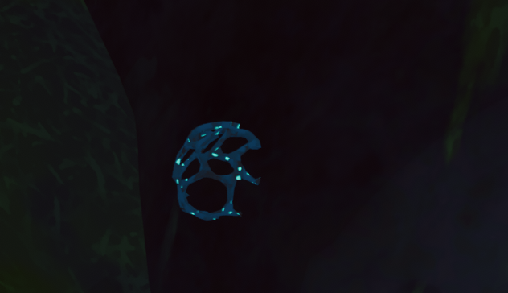

# Warp Fungus

This page is a [stub](https://support.wiki.gg/wiki/Stub). You can help **PEAK Wiki** by expanding it.

Warp Fungus

[Item type](Items.md)- [Consumable](https://peak.wiki.gg/wiki/Consumable)
Weight
 **2.5**

The **Warp Fungus** is a [consumable](https://peak.wiki.gg/wiki/Consumable) item in *[PEAK](Peak%20%28game%29.md)*. When dropped or thrown, it teleports the user to the location that it lands. The **Warp Fungus** can be found in all biomes except biomes past the [Alpine](Alpine.md) and [Mesa](Mesa.md). The **Warp Fungus** is extremely rare to find especially in the [Alpine](Alpine.md) due too its icy walls that are a similar color to the **Warp Fungus**.

## Gallery

A **Warp Fungus** found in the [Tropics](Tropics.md)

## Patch history

 **[2.0.a](2.0.a.md) (2026-08-11):** Introduced.
