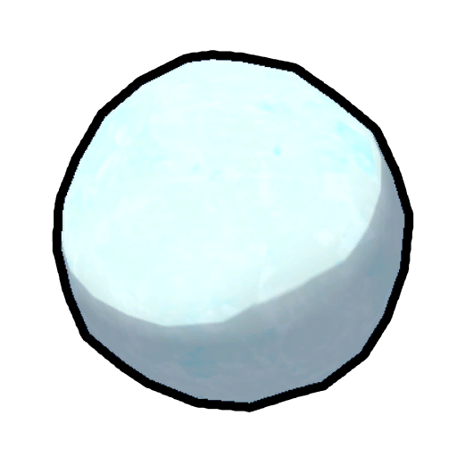
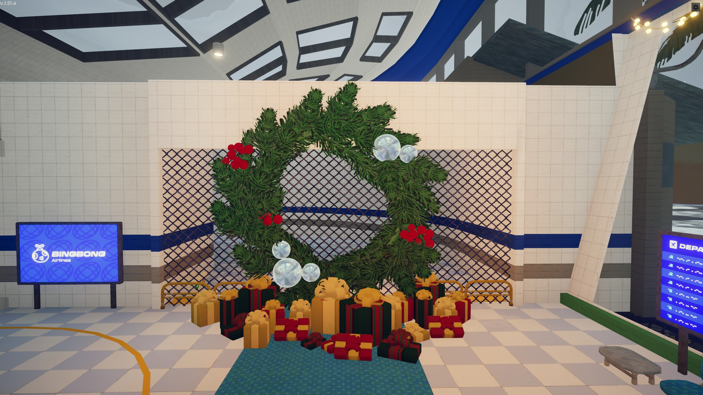
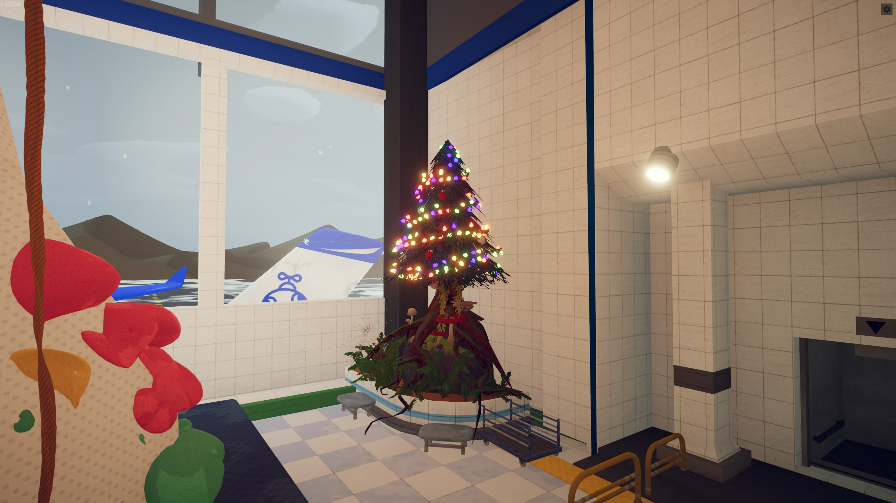
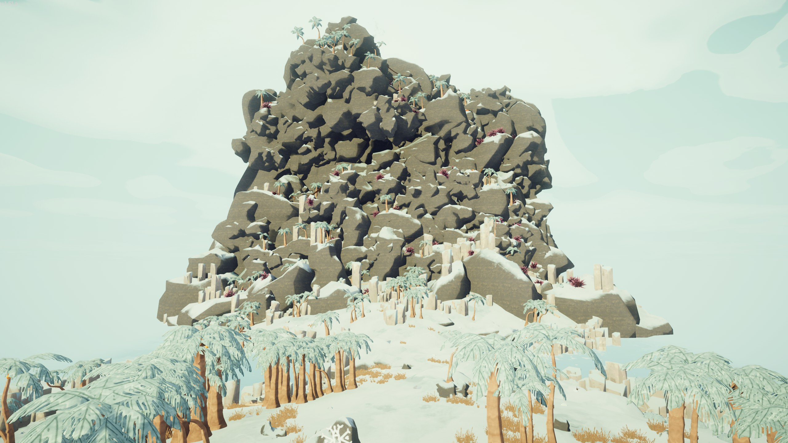
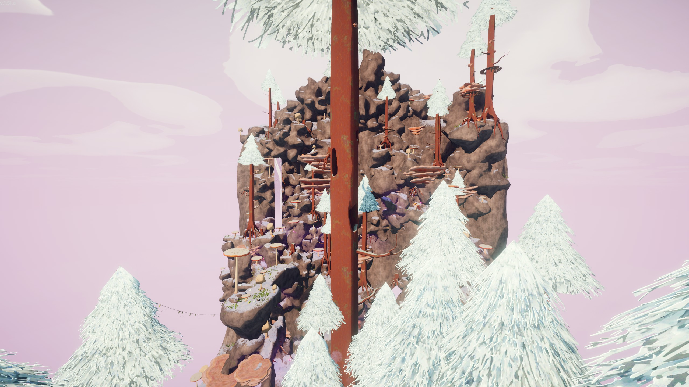
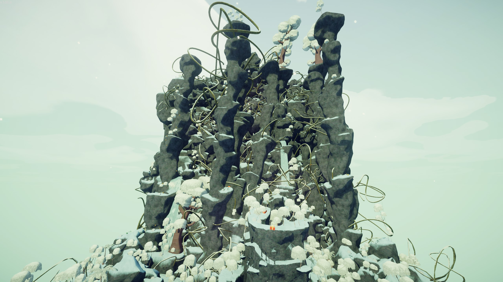
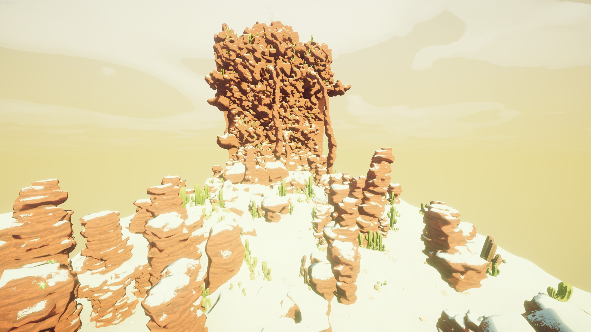
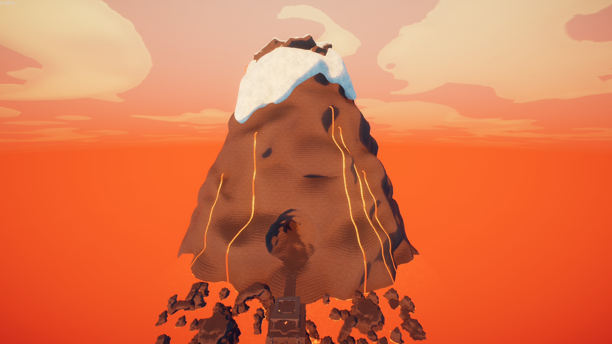
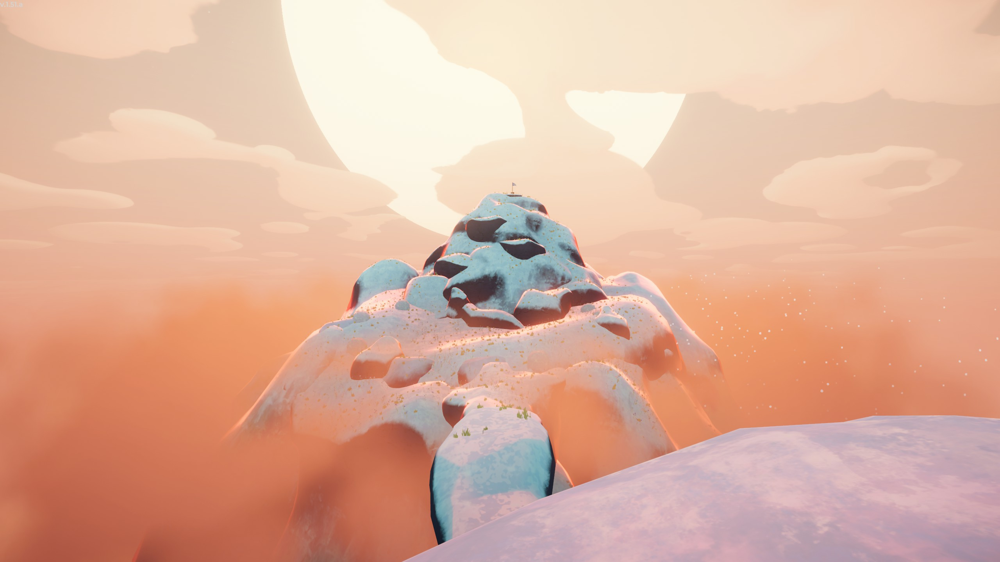
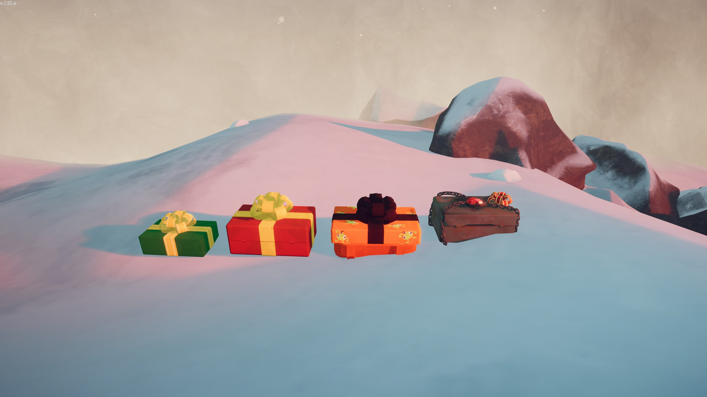

# Winter Map

During the 2025 Holiday Season, the maps for all [locations](https://peak.wiki.gg/wiki/Location) were updated to foster some holiday cheer. While the Winter Update was in effect, the following features were active:

- The [Airport](Airport.md) was decorated with Christmas lights, wreathes, ornaments and gifts.
- All biomes except the Caldera were snowed over. A cosmetic snowing effect could be seen at times.
- Snow piles would generate throughout the map and could be picked up to obtain a  [Snowball](Snowball.md). Snow piles could be found in the following biomes:- [Shore](Shore.md)
  - [Roots](Roots.md)
  - [Mesa](Mesa.md)
  - [Alpine](Alpine.md)
- [Luggage](Luggage.md) were reskinned to look like Christmas gifts.
- [Bing Bong](Bing%20Bong.md) and [Ancient Idol](Ancient%20Idol.md) wore Santa hats.

## Gallery

- 
  The [Airport Photobooth](Airport.md#Photobooth) featured a wreath and Christmas gifts
- 
  A view of the Airport showing off various Christmas decorations
- 
  A large wreath and a pile of presents in the Airport
- 
  A Christmas tree in the corner near the climbing wall in the Airport
- 
  A view of [Shore](Shore.md) covered in snow
- 
  A view of the [Roots](Roots.md) covered in snow
- 
  A view of the [Tropics](Tropics.md) covered in snow
- 
  A snowy [Mesa](Mesa.md) where the sun's heat would still burn players
- 
  The volcano with a snowy summit as seen from the [Caldera](Caldera.md)
- 
  The [Peak](Peak%20%28biome%29.md) covered in snow
- 
  [Luggage](Luggage.md) decorated like Christmas presents
- 
  [Bing Bong](Bing%20Bong.md) with a Santa hat
- 
  The [Ancient Idol](Ancient%20Idol.md) with a Santa hat

## Patch history

 **[1.50.a](1.50.a.md) (2025-12-16):**

- WINTER UPDATE We just updated the game with some holiday cheer! You'll find the airport lobby is looking a little more festive BUT THAT'S NOT ALL...
- Biomes will now be snowed over where applicable! Obviously The Caldera won't have snow because well....lava.... BUT the rest of them should be snowed over for PEAK holiday vibes. If you live in the southern hemisphere like some of us do, just don't worry about it.
- You should also be able to find snow mounds throughout the level, interact with them to form....a snowball. The ultimate weapon for enraging your friends.

 **[1.52.a](1.52.a.md) (2026-01-06):** Removed the holiday event changes (except snow piles which can still be found in Alpine)
