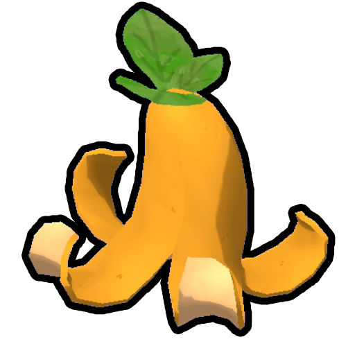

# Yellow Berrynana Peel

Yellow Berrynana Peel

[Item type](Items.md)- [Misc](Misc.md)
Biome- [Tropics](Tropics.md)
- [Gloom](Gloom.md)
Source- [Yellow Berrynana](Yellow%20Berrynana.md)
- [Clown Luggage](https://peak.wiki.gg/wiki/Clown_Luggage)
Weight
 **2.5**

The **Yellow Berrynana Peel** is an [item](https://peak.wiki.gg/wiki/Item) in *[PEAK](Peak%20%28game%29.md)* that is acquired after eating  [Yellow Berrynanas](Yellow%20Berrynana.md) from the [Tropics](Tropics.md) or the [Gloom](Gloom.md). Players walking over a peel will [slip](https://peak.wiki.gg/wiki/Slippery_effect) and fall to the ground, losing control for a moment. It can also be obtained on its own in [Clown Luggage](https://peak.wiki.gg/wiki/Clown_Luggage).

## Patch history

 **[1.0](1.0.md) (2025-06-16):** Introduced.
