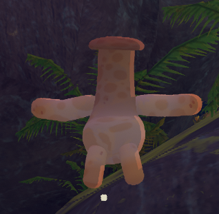
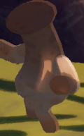

# Zombie Phobia Mode

**Zombie Phobia Mode** is an option in *[PEAK](Peak%20%28game%29.md)* which replaces the [Zombie](Zombie.md) default model to an enlarged [Chubby Shroom](Chubby%20Shroom.md) with limbs to make the game less scary. It can be toggled in the [settings](Settings.md).

Despite appearing as mushrooms with limbs, Zombies will still become skeletons upon death with Zombie Phobia Mode on.

Zombie Phobia Mode has no effect on gameplay and only changes the model and sound effects of the [Zombies](Zombie.md).

## Gallery

- 
  The [Zombie](Zombie.md) once Zombie Phobia Mode is toggled on.
- 
  Ditto.

## Patch history

 **[1.60.a](1.60.a.md) (2026-03-30):** Introduced.
