# 方山

方山
[File:方山.png](https://peak.wiki.gg/wiki/Special%3AUpload%3FwpDestFile%3D%E6%96%B9%E5%B1%B1.png)
一般
類型
生態系

**方山**是Template:PEAK 遊戲中可能出現的第三關卡之一，與森蕈每隔兩天會輪流一次。這個生態系又熱又乾並且被一條[大峽谷](#大峽谷)分割成兩邊。

方山最主要的危害來自於[太陽](#烈陽)，玩家在白天時需要四處尋找陰影躲避。

達到方山山頂並點燃營火便能讓所有存活的童軍獲得Template:獎章。

## 地貌

### 高原區

---

[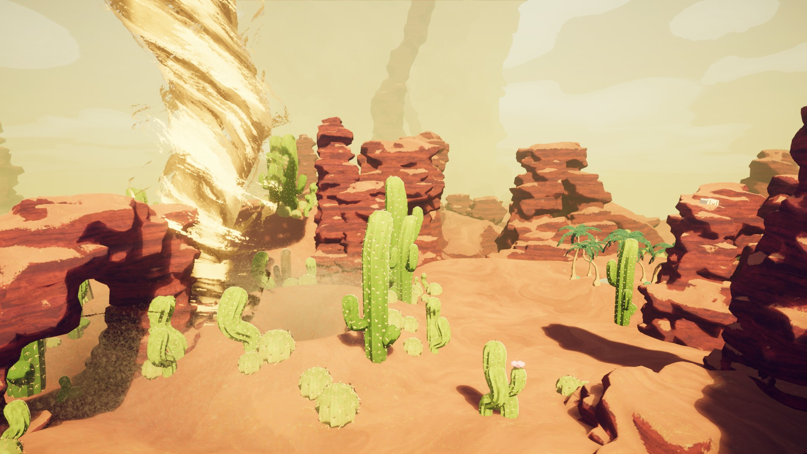](https://peak.wiki.gg/wiki/File%3AMesa_3.jpg)

**高原**是方山最開始的區域，也就是在大峽谷以前的區塊。這裡有大量的[仙人掌](#仙人掌)和各種樣式的石柱，有些石柱也會形成天然拱門和遮蔽處。

高原區也有許多專有的[危害](#危害)，像是龍捲風、[風滾草](#風滾草)和蟻獅，但這裡因為遮蔽物較少，因此最主要的危害仍是[烈陽](#烈陽)，玩家在行動時需要更小心地規劃路線。

#### 綠洲

[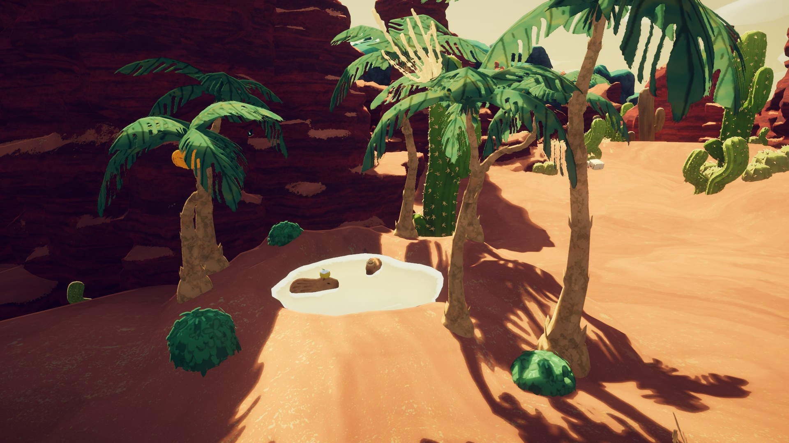](https://peak.wiki.gg/wiki/File%3AMesa_oasis_2.jpg)

綠洲位於高原區，地貌組成會有一小池的泉水和圍繞在四周的椰子樹。泉水中可以見到數隻水豚，其中一隻頭上會頂著[黃雪莓](https://peak.wiki.gg/wiki/Special%3AUpload%3FwpDestFile%3D%E9%BB%83%E9%9B%AA%E8%8E%93.png) 黃雪莓供玩家食用，四周椰子樹上也會生成[椰子](https://peak.wiki.gg/wiki/Special%3AUpload%3FwpDestFile%3D%E6%A4%B0%E5%AD%90.png) 椰子。當玩家站在泉水中可以降溫，幫助玩家消除累積的 [燒傷](%E8%83%BD%E9%87%8F%E6%A2%9D.md#燒傷)。

方山中的綠洲與森蕈中的溫泉有著相同的效果和定位。

#### 墓穴入口

Main article: 墓穴
[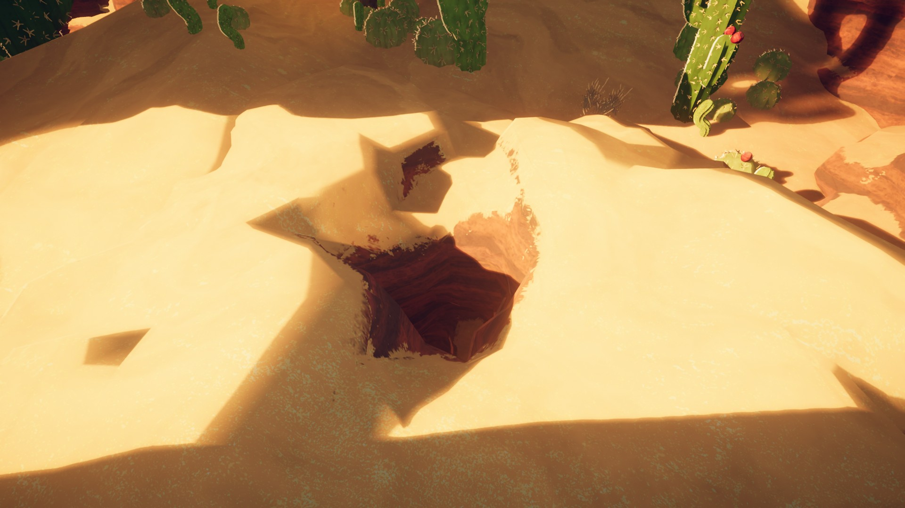](https://peak.wiki.gg/wiki/File%3ATomb_hole.jpg)

高原區可以找到通往墓穴的入口，但並非每一次輪到方山地圖都會有墓穴入口，隨機生成的地形有機會將入口處封死。

#### 海市蜃樓

- [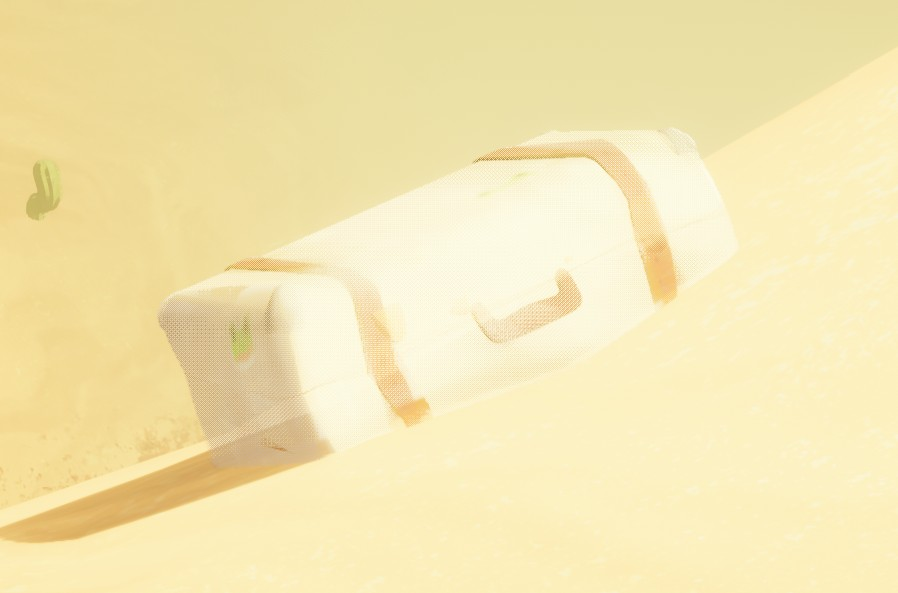](https://peak.wiki.gg/wiki/File%3AMirage_luggage.jpg)
  大型行李箱的海市蜃樓。
- [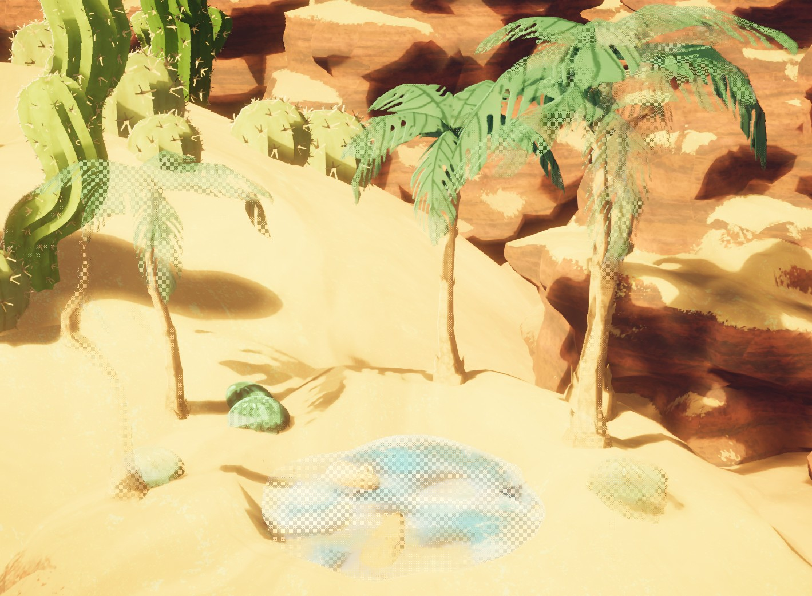](https://peak.wiki.gg/wiki/File%3AMirage_oasis.jpg)
  [綠洲](#綠洲)的海市蜃樓。

**海市蜃樓**是方山獨有的特色。玩家會看見遠處行李箱或甚至整片綠洲的海市蜃樓，但靠近之後這些幻影便會消失。

### 大峽谷

---

[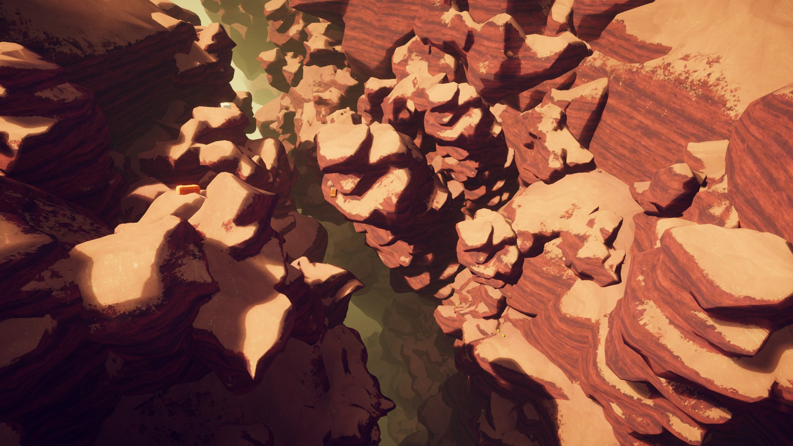](https://peak.wiki.gg/wiki/File%3AMesa_canyon_1.jpg)

大峽谷是方山的第二個區域，他將整個方山隔成了[高原](#高原)和[洞穴](#洞穴)兩個區塊。玩家可能需要一路向下到谷底再往回爬才能穿越大峽谷，但[童子軍大砲](https://peak.wiki.gg/wiki/Special%3AUpload%3FwpDestFile%3D%E7%AB%A5%E5%AD%90%E8%BB%8D%E5%A4%A7%E7%A0%B2.png) 童子軍大砲可以幫助玩家快速通過大峽谷並獲得Template:獎章。

### 洞穴區

---

- [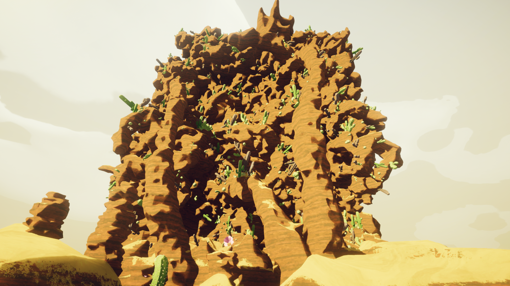](https://peak.wiki.gg/wiki/File%3AMesa_wall.png)
  方山包含洞穴區的垂直攀爬區。
- [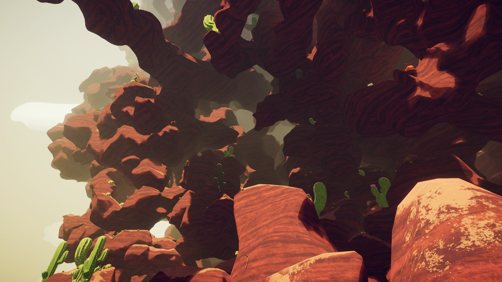](https://peak.wiki.gg/wiki/File%3AMesa_caves_1.jpg)
  洞穴區近照。

**洞穴區**是方山中的最後區塊，玩家要嘗試攀越錯藂複雜的地形來抵達營火。洞穴內側能夠很好的遮蔽[烈陽](#烈陽)，但玩家大多數時候還是需要在洞穴外側攀爬。

#### 礦井

[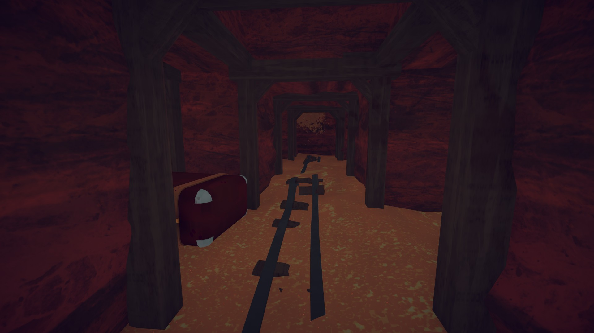](https://peak.wiki.gg/wiki/File%3AMineshaft_2.jpg)

礦井是洞穴區偶爾會找到的一個小迷宮，內部通常會含有一個一般行李箱，但也同時布滿許多[炸藥](https://peak.wiki.gg/wiki/Special%3AUpload%3FwpDestFile%3D%E7%82%B8%E8%97%A5.png) 炸藥，在探索時要特別小心。

#### 十字鎬

[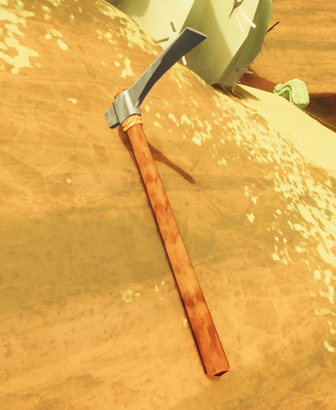](https://peak.wiki.gg/wiki/File%3APickaxe.png)

老舊的 **[十字鎬](%E5%B2%A9%E9%87%98.md#十字鎬)** 會隨機生成在洞穴區的岩壁上，它們的用法語 [岩釘](%E5%B2%A9%E9%87%98.md)相同，但在握住**6秒**後毀損。

## 危害

| 危害 | 圖片 | 說明 |
| --- | --- | --- |
| **烈陽** | [Mesa sun.jpg](https://peak.wiki.gg/wiki/File%3AMesa_sun.jpg) | 方山的烈陽非常燙，它會讓曝曬的玩家以每秒獲得[燒傷](%E8%83%BD%E9%87%8F%E6%A2%9D.md#燒傷) **5** [燒傷](%E8%83%BD%E9%87%8F%E6%A2%9D.md#燒傷)。玩家需要找到遮蔽物、使用[太陽傘](https://peak.wiki.gg/wiki/Special%3AUpload%3FwpDestFile%3D%E5%A4%AA%E9%99%BD%E5%82%98.png) 太陽傘或[防曬噴霧](https://peak.wiki.gg/wiki/Special%3AUpload%3FwpDestFile%3D%E9%98%B2%E6%9B%AC%E5%99%B4%E9%9C%A7.png) 防曬噴霧來阻擋陽光的危害。使用[蘆薈](https://peak.wiki.gg/wiki/Special%3AUpload%3FwpDestFile%3D%E8%98%86%E8%96%88.png) 蘆薈可以有效地緩解燒傷。 |
| **仙人掌** | [Big cacti.png](https://peak.wiki.gg/wiki/File%3ABig_cacti.png) | 方山隨處可見許多[仙人掌](https://peak.wiki.gg/wiki/%E4%BB%99%E4%BA%BA%E6%8E%8C)和[仙人掌球](https://peak.wiki.gg/wiki/Special%3AUpload%3FwpDestFile%3D%E4%BB%99%E4%BA%BA%E6%8E%8C%E7%90%83.png) 仙人掌球。玩家誤觸時會被短暫地刺在仙人掌上無法動彈，並同時獲得[尖刺](%E8%83%BD%E9%87%8F%E6%A2%9D.md#尖刺) [尖刺](%E8%83%BD%E9%87%8F%E6%A2%9D.md#尖刺)。多人模式下，玩家可以透過**幫助鍵Mouse right.png**來幫助其他人脫離仙人掌。 |
| **風滾草** | [Tumbleweed.png](https://peak.wiki.gg/wiki/File%3ATumbleweed.png) | 風滾草是方山中隨風滾動的球狀物乾草堆。它們會撞擊粗心的玩家，造成[尖刺](%E8%83%BD%E9%87%8F%E6%A2%9D.md#尖刺) [尖刺](%E8%83%BD%E9%87%8F%E6%A2%9D.md#尖刺)的同時將玩家撞飛到危險的區域。 |
| **龍捲風** | [Mesa tornado.png](https://peak.wiki.gg/wiki/File%3AMesa_tornado.png) | **龍捲風**會生成在方山的高原區。它的行動軌跡無法預測，會將所有靠近的玩家捲入並吹飛。 |
| **蟻獅** | [Antlion trap.png](https://peak.wiki.gg/wiki/File%3AAntlion_trap.png) | 蟻獅坑中心會有一個**假的**探險家行李作為誘餌，當玩家靠近時會攻擊玩家造成大量的[受傷](%E8%83%BD%E9%87%8F%E6%A2%9D.md#受傷) [受傷](%E8%83%BD%E9%87%8F%E6%A2%9D.md#受傷)。 |
| **蠍子** | [Scorpion closeup.png](https://peak.wiki.gg/wiki/File%3AScorpion_closeup.png) | 洞穴區遍布許多[蠍子](https://peak.wiki.gg/wiki/Special%3AUpload%3FwpDestFile%3D%E8%A0%8D%E5%AD%90.png) 蠍子。它們會主動攻擊靠近的玩家，給予大量的[中毒](%E8%83%BD%E9%87%8F%E6%A2%9D.md#中毒) [中毒](%E8%83%BD%E9%87%8F%E6%A2%9D.md#中毒)。 |
| **[Dynamite](Dynamite.md)** | [Dynamite closeup.png](https://peak.wiki.gg/wiki/File%3ADynamite_closeup.png) | **[Dynamite](Dynamite.md)** is scattered all throughout the Caves, embedded into the ground and walls. It lights up when a player is nearby and explodes shortly after, [Injury](Stamina%20bar.md#Injury) [injuring](Stamina%20bar.md#Injury) close players and knocking them back. |

## Food

The following food items can be found in the Mesa, excluding packaged food from Luggage.

-  [Coconut](Coconut.md) (removes [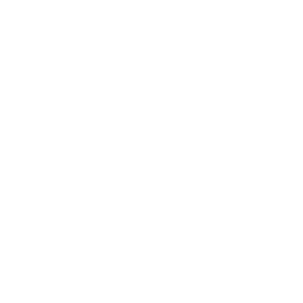](Stamina%20bar.md#Heat) [Heat](Stamina%20bar.md#Heat))
-  [Yellow Winterberry](Yellow%20Winterberry.md) (heals  [Injury](Stamina%20bar.md#Injury))
-  [Red Prickleberry](Red%20Prickleberry.md) ( [Thorns](Stamina%20bar.md#Thorns))
-  [Gold Prickleberry](Gold%20Prickleberry.md) ( [Thorns](Stamina%20bar.md#Thorns), heals  [Injury](Stamina%20bar.md#Injury))
-  [Button Shroom](Button%20Shroom.md)
-  [Button Shroom (Poisonous)](https://peak.wiki.gg/wiki/Button_Shroom_%28Poisonous%29)
-  [Bugle Shroom](Bugle%20Shroom.md)
-  [Bugle Shroom (Poisonous)](https://peak.wiki.gg/wiki/Bugle_Shroom_%28Poisonous%29)
-  [Cluster Shroom](Cluster%20Shroom.md)
-  [Cluster Shroom (Poisonous)](https://peak.wiki.gg/wiki/Cluster_Shroom_%28Poisonous%29)
-  [Chubby Shroom](Chubby%20Shroom.md)
-  [Scorpion](Scorpion.md) (requires [cooking](Cooking.md) using fire or [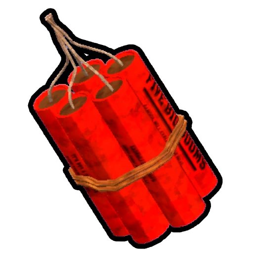](Dynamite.md) [Dynamite](Dynamite.md))

## Natural Items

The following natural items can appear in the Mesa.

- [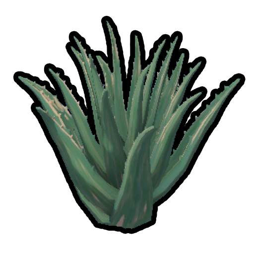](Aloe%20Vera.md) [Aloe Vera](Aloe%20Vera.md)
-  [Dynamite](Dynamite.md)
-  [Shelf Fungus](Shelf%20Fungus.md)
-  [Remedy Fungus](Remedy%20Fungus.md)
-  [Magic Bean](Magic%20Bean.md)

## Variants

While the game is generating the Mesa, it randomly selects a variant to apply. Each variant has its own chance of appearing:

Mesa Variants

| Variant | Weight | Image | Description |
| --- | --- | --- | --- |
| No Variant | 10 |  | Does nothing |
| Cactus Forest | 5 | [Mesa Cactus Forest.jpg](https://peak.wiki.gg/wiki/File%3AMesa_Cactus_Forest.jpg) | Significantly more [Cacti](Mesa.md#Cacti) spawn on the plateau than usual |
| Cactus Hell | 5 | [Mesa Cactus Hell.jpg](https://peak.wiki.gg/wiki/File%3AMesa_Cactus_Hell.jpg) | Significantly more [Cacti](Mesa.md#Cacti) spawn on the climb than usual |
| Dynamite Hell | 5 | [Mesa Dynamite Hell.jpg](https://peak.wiki.gg/wiki/File%3AMesa_Dynamite_Hell.jpg) | Significantly more  [Dynamite](Dynamite.md) spawns on the ground |
| Scorpions Hell | 5 | [Mesa Scorpions Hell.jpg](https://peak.wiki.gg/wiki/File%3AMesa_Scorpions_Hell.jpg) | Significantly more  [Scorpions](Scorpion.md) spawn |
| Tornado Hell | 2 | [Mesa Tornado Hell.jpg](https://peak.wiki.gg/wiki/File%3AMesa_Tornado_Hell.jpg) | Tornadoes spawn much more frequently |
| Tumbler Hell | 3 | [Mesa Tumbler Hell.jpg](https://peak.wiki.gg/wiki/File%3AMesa_Tumbler_Hell.jpg) | Tumblers are 2.5x as common as normal |

## Tips & Tricks

- Mirages can be determined by using the ping system. If the ping hand lands on the [Luggage](Luggage.md) or [Oasis](#Oasis) tree normally, then it is real, but if it hits the ground behind it instead, it's a mirage. This method can be used to avoid going after fake luggage and wasting time.
- If possible, wait until night time to traverse the Mesa's first half. The lack of burning sun will make the journey to the [Canyon](#Canyon) much smoother. This might not be applicable on [Ascent 5](Ascents.md) and higher, due to the night's  [Cold](Stamina%20bar.md#Cold) nature.
- Use the Canyon's depth to your advantage during the day, as it will protect you from the sun until you reach the cliffside.
- Both  [Scorpions](Scorpion.md) and  [Dynamite](Dynamite.md) can be quickly picked up and tossed away with the right timing. If you see a Scorpion or Dynamite in your path, grab it and toss it as far as you can. You can charge the throw meter almost all the way up before the Scorpion even begins to charge its attack.
- You can stop the sun from burning you by holding an item and pointing it directly at the sun. The game only checks for a line of sight between the sun and your [Scout](Scout.md)'s center, so breaking it will prevent the sun from causing  [Heat](Stamina%20bar.md#Heat).

## Trivia

- The Mesa is the first [biome](https://peak.wiki.gg/wiki/Biome) to be added after the game's initial launch.
- The Mesa is the first biome that can potentially replace another biome in an [island](Island.md) rotation.

## Gallery

### General

---

- [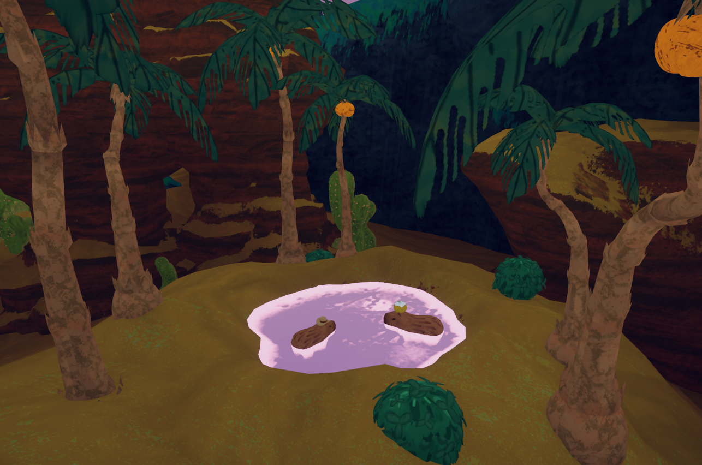](https://peak.wiki.gg/wiki/File%3AMesa_oasis.png)
  Another Oasis
- [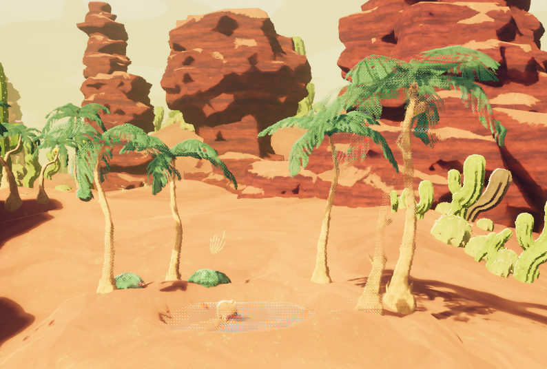](https://peak.wiki.gg/wiki/File%3AMesa_oasis_mirage.png)
  Another mirage of an Oasis
- [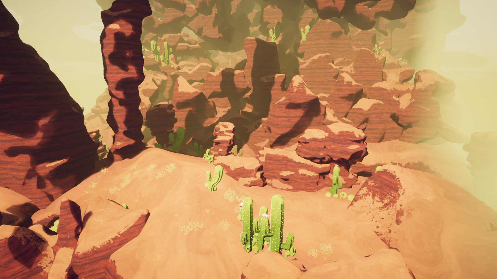](https://peak.wiki.gg/wiki/File%3AAfter_canyon.jpg)
  The area between the Canyon and the Caves
- [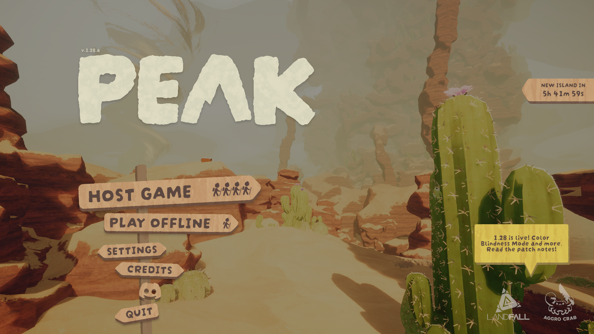](https://peak.wiki.gg/wiki/File%3ATitle_screen_Mesa.png)
  Mesa on the title screen of Patch [1.28.a](1.28.a.md)

### Plateau

---

- [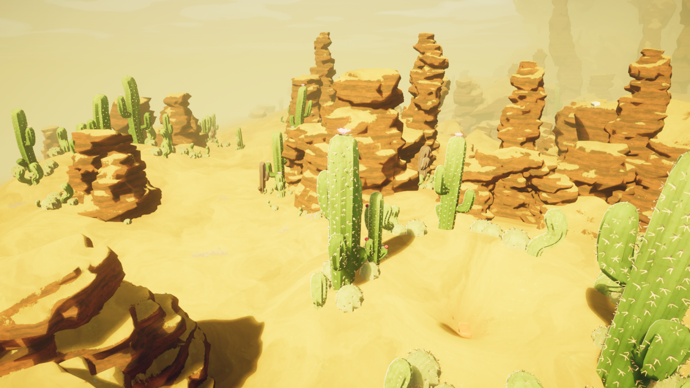](https://peak.wiki.gg/wiki/File%3AMesa_Location.png)
- [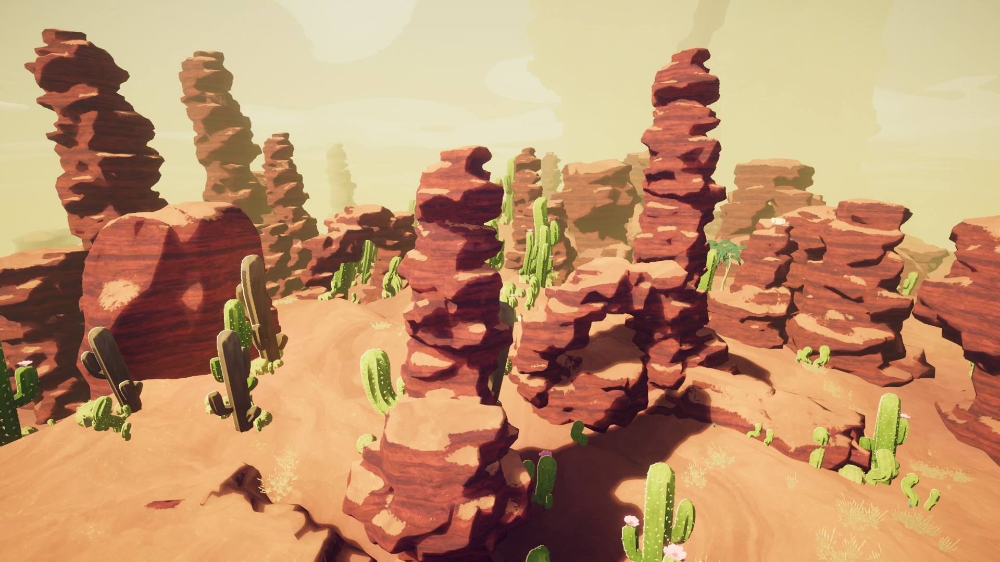](https://peak.wiki.gg/wiki/File%3AMesa_2.jpg)
- 

### Canyon

---

- 
- [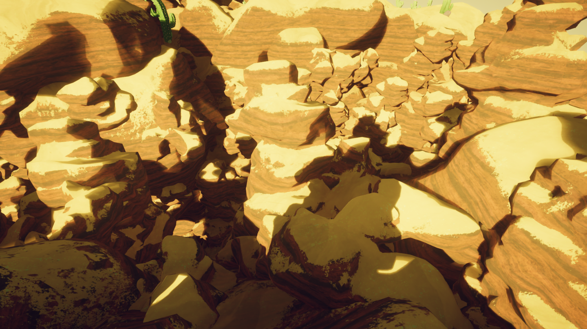](https://peak.wiki.gg/wiki/File%3AMesa_canyon.png)
- [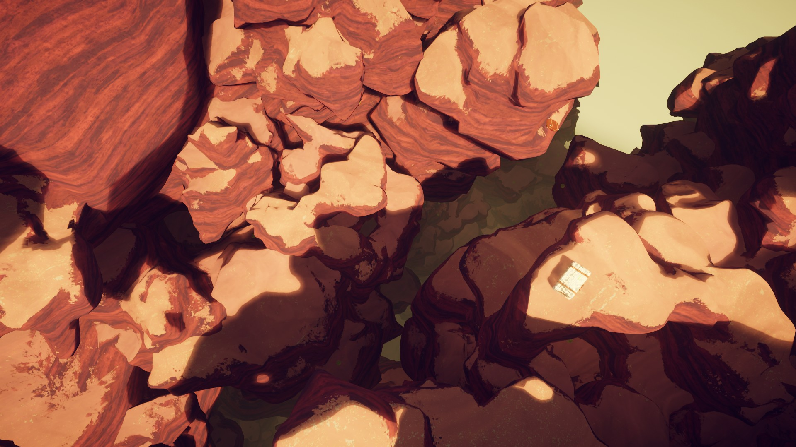](https://peak.wiki.gg/wiki/File%3AMesa_canyon_2.jpg)

### Caves

---

- [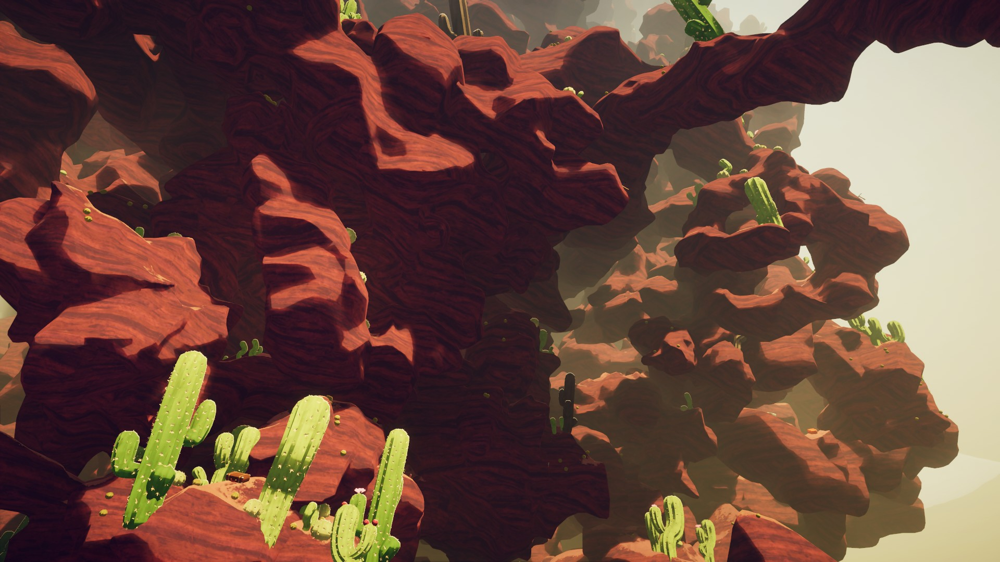](https://peak.wiki.gg/wiki/File%3AMesa_caves_2.jpg)
- [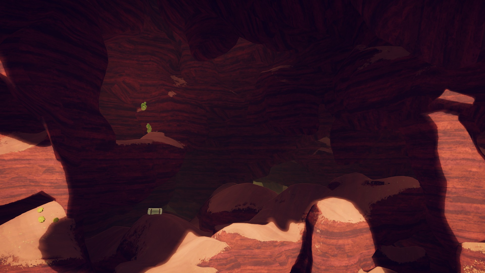](https://peak.wiki.gg/wiki/File%3AMesa_caves_3.jpg)
- [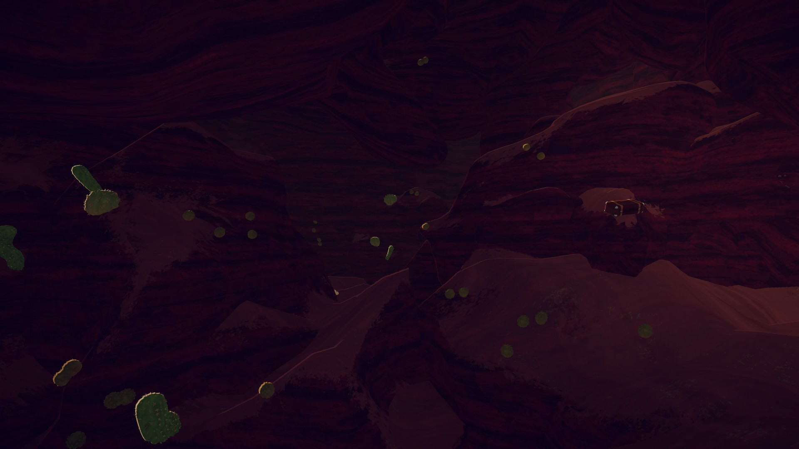](https://peak.wiki.gg/wiki/File%3AMesa_caves_4.jpg)
- [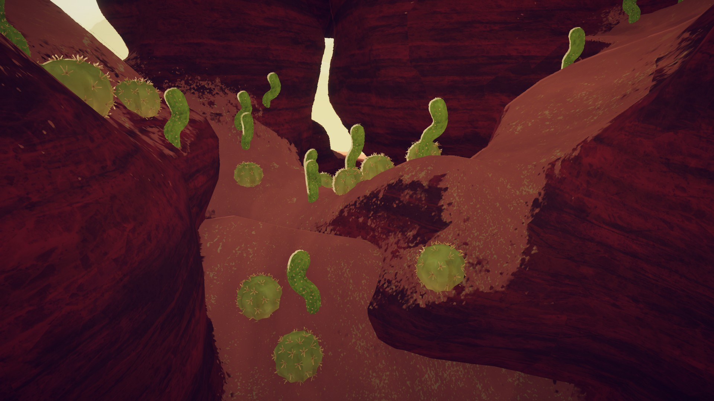](https://peak.wiki.gg/wiki/File%3ALots_of_cacti.jpg)
  A cave with lots of small [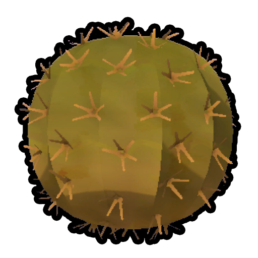](Cactus.md) [Cacti](Cactus.md)

### Mine shafts

---

- [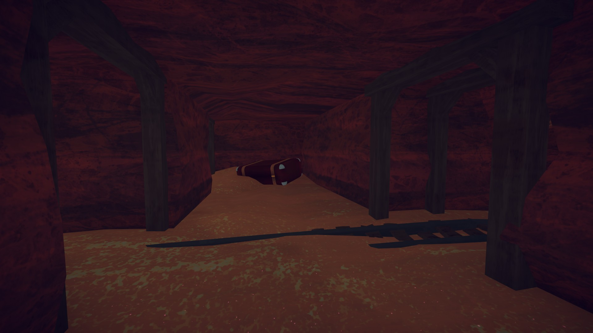](https://peak.wiki.gg/wiki/File%3AMineshaft_1.jpg)
- 
- [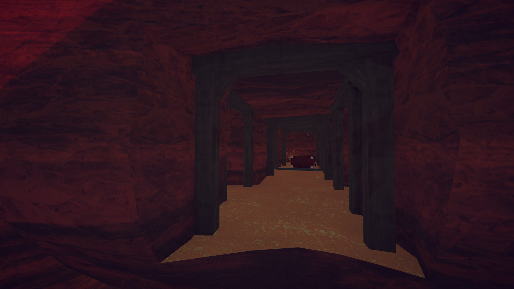](https://peak.wiki.gg/wiki/File%3AMineshaft_3.jpg)
- [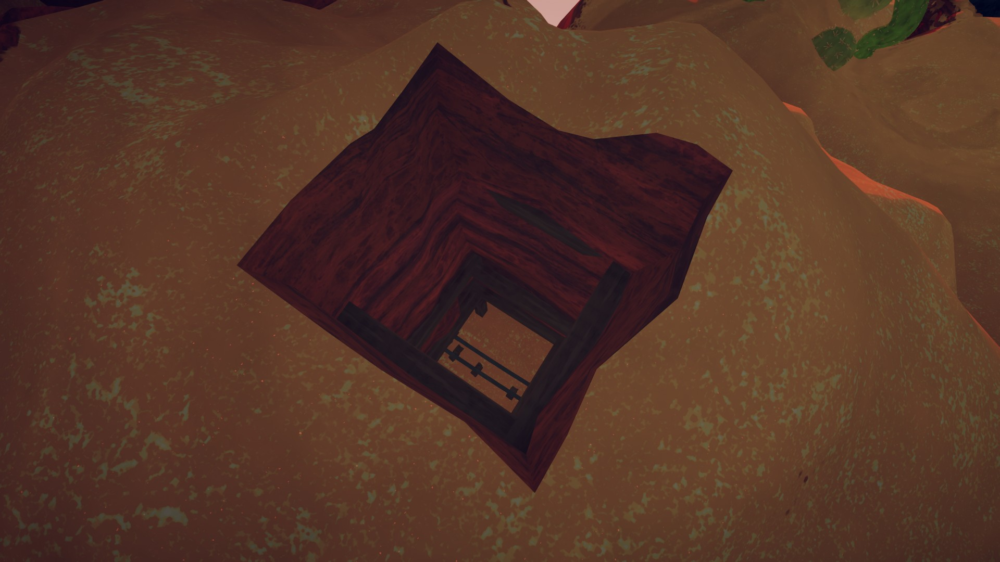](https://peak.wiki.gg/wiki/File%3AMineshaft_top.jpg)
  Mine shafts can have an additional entrance at the top

## Patch history

 **[1.20.a](1.20.a.md) (2025-08-11):** Introduced.
 **[1.23.a](1.23.a.md) (2025-08-13):**

- [Tumbleweed](Tumbleweed.md) damage and knockback has been made more consistent.
- Tumbleweeds now deal [Thorns](https://peak.wiki.gg/wiki/Thorns) damage instead of [Injury](https://peak.wiki.gg/wiki/Injury).
- [Dynamite](Dynamite.md) now spawns in [luggage](Luggage.md) slightly less often.
- [Scorpions](Scorpion.md) will now deal less [Poison](https://peak.wiki.gg/wiki/Poison) damage depending on how close you already are to passing out.
- Scorpions will now require line-of-sight to aggro you.
- Tumbleweed damage and knockback now scales with the size of the tumbleweed.
- Dynamite will no longer damage you through walls.
- Reduced scorpion aggro radius and movement speed slightly.
- Performance has been improved in the MESA.
- Fixed an issue where MESA-specific items wouldn’t spawn until the end of the MESA.

 **[1.23.b](1.23.b.md) (2025-08-14):** This hotfix just fixes the bug where players screens would turn green/black/glitchy during the climb up the MESA.
 **[1.27.a](1.27.a.md) (2025-08-27):**

- The [ALPINE](Alpine.md) and the MESA will now alternate every other day.
- A [secret entrance](Tomb.md) in the MESA is now open 50% of the time instead of 25%. Feels fair considering the MESA itself is now open 50% of the time as well.

 **[1.28.a](1.28.a.md) (2025-09-08):**

- Slightly reduced the commonness of the "Tornado Hell" biome variant,
- It is now wayyy less likely that the maze is blocked after entering the [TOMB](Tomb.md).
