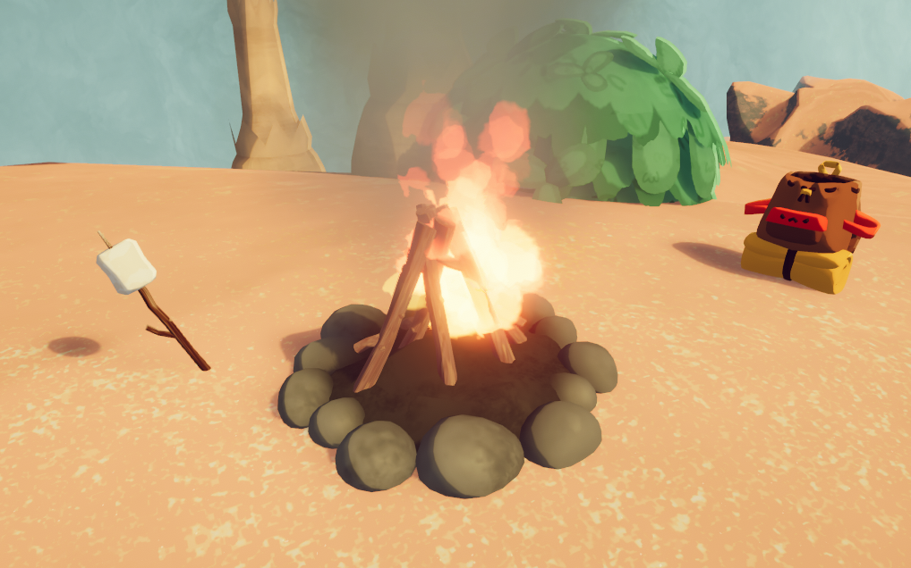

# 烹飪

烹飪

一般
類型
機制

**烹飪**是Template:PEAK 遊戲中的一個機制，玩家需要尋找熱源才能進行烹飪，烹飪過的[道具](%E9%81%93%E5%85%B7.md)或[食物](%E9%A3%9F%E7%89%A9.md)各自會獲得不同效果。

大多數的食物在烹飪後都會獲得正向的效果，而道具的烹飪效果則有利有弊。

## 熱源

玩家手持物品時對著熱源進行互動便能完成烹飪，熱源可以是營火、失事地點的火或是[便攜火爐](https://peak.wiki.gg/wiki/Special%3AUpload%3FwpDestFile%3D%E4%BE%BF%E6%94%9C%E7%81%AB%E7%88%90.png) 便攜火爐。

此外，大多數的爆炸也能將爆炸範圍內的道具或食物煮熟，例如[炸藥](https://peak.wiki.gg/wiki/Special%3AUpload%3FwpDestFile%3D%E7%82%B8%E8%97%A5.png) 炸藥。

在火山和熔爐中，掉落在高溫地面上的道具或食物也會被煮熟，甚至掉落進岩漿時烹飪速度會更快速。到具在玩家手上或是在未裝備的[背包](https://peak.wiki.gg/wiki/Special%3AUpload%3FwpDestFile%3D%E8%83%8C%E5%8C%85.png) 背包時也同樣會套用此機制。

## 烹飪階段

大多數的[食物](%E9%A3%9F%E7%89%A9.md)在烹飪過程中會歷經4個烹飪階段，每一階段會讓道具的顏色變得更深一點。

| 階段 | 名稱 | 效果 |
| --- | --- | --- |
| 1 | **煮熟了** | - Restored [Hunger](Stamina%20bar.md#Hunger) [Hunger](Stamina%20bar.md#Hunger) is doubled. - [Bonus stamina](Stamina%20bar.md#Bonus_stamina) [Bonus stamina](Stamina%20bar.md#Bonus_stamina) is multiplied by **x1.5**- Cooked food gives at least [Bonus stamina](Stamina%20bar.md#Bonus_stamina) **10** [Bonus stamina](Stamina%20bar.md#Bonus_stamina) even if it didn't give any before. - For [berries](https://peak.wiki.gg/wiki/Berries) (including [Shroomberries](https://peak.wiki.gg/wiki/Shroomberries)):- Removes any [Thorns](Stamina%20bar.md#Thorns) [Thorns](Stamina%20bar.md#Thorns) and [Poison](Stamina%20bar.md#Poison) [Poison](Stamina%20bar.md#Poison)   - Reduces [Spores](Stamina%20bar.md#Spores) [Spores](Stamina%20bar.md#Spores) by **5**.  (Both stages are identical and do not stack their effects) |
| 2 | **Well-Done** |
| 3 | **Burnt** | - **5** less [Hunger](Stamina%20bar.md#Hunger) [Hunger](Stamina%20bar.md#Hunger) restored compared to the previous stage. |
| 4 | **Incinerated** | - Adds [Poison](Stamina%20bar.md#Poison) **10** [Poison](Stamina%20bar.md#Poison) for each time the food is incinerated (up to a maximum of **90**). - [Equipment](Equipment.md) items break and stop working. |

Some food items, like the  [Cooked Bird](Cooked%20Bird.md), are precooked and do not occur uncooked.

## Special cooking effects

Almost any item can be cooked. Many items have alternate or additional effects when cooked. Items that explode are destroyed. Unless otherwise specified, the default effects of cooking still apply. See the corresponding item pages for more details.

| Item | Effect |
| --- | --- |
| [Anti-Rope Cannon](Anti-Rope%20Cannon.md) | Incinerated and unusable |
| [Anti-Rope Spool](Anti-Rope%20Spool.md) | Incinerated and unusable |
| [Antidote](Antidote.md) | Explodes into a small cloud of [Poison](Stamina%20bar.md#Poison) [Poison](Stamina%20bar.md#Poison) healing without inflicting knockback |
| [Backpack](Backpack.md) | Visual-only. Can still hold items even when repeatedly incinerated |
| [Balloon](Balloon.md) | Pops |
| [Balloon Bunch](Balloon%20Bunch.md) | Pops |
| [Bandages](Bandages.md) | Visual-only |
| [Basketball](Basketball.md) | Pops |
| [Big Lollipop](Big%20Lollipop.md) | Removes [Drowsy](Stamina%20bar.md#Drowsy) [Drowsy](Stamina%20bar.md#Drowsy) penalty after use |
| [Bing Bong](Bing%20Bong.md) | - Lowers pitch and volume of voice lines - Stops playing voice lines when Incinerated |
| [Blowgun](Blowgun.md) | [Drowsy](Stamina%20bar.md#Drowsy) **120** [Drowsy](Stamina%20bar.md#Drowsy) is replaced with [Heat](Stamina%20bar.md#Heat) **150** [Heat](Stamina%20bar.md#Heat) |
| [Bugle](Bugle.md) | Makes the pitch wobble more each time it is cooked |
| [Chain Launcher](Chain%20Launcher.md) | Incinerated and unusable |
| [Cure-All](Cure-All.md) | Explodes into a small cloud of healing without inflicting knockback |
| [Cursed Skull](Cursed%20Skull.md) | Activates immediately, then explodes with a [dynamite](Dynamite.md) explosion |
| [Dynamite](Dynamite.md) | Immediately explodes |
| [Energy Drink](Energy%20Drink.md) | - When consumed, explodes and knocks back players within a large radius - Effect duration is increased by 4 seconds - No additional [Drowsy](Stamina%20bar.md#Drowsy) [Drowsy](Stamina%20bar.md#Drowsy) (previous Drowsy still restored) |
| [Faerie Lantern](Faerie%20Lantern.md) | Explodes into a small cloud of healing |
| [First Aid Kit](First%20Aid%20Kit.md) | Visual-only |
| [Flare](Flare.md) | Explodes, dealing [Injury](Stamina%20bar.md#Injury) [Injury](Stamina%20bar.md#Injury) in a small radius |
| [Fortified Milk](Fortified%20Milk.md) | Increases the effect duration by 10 seconds if at all cooked. Receives no other cooking effects |
| [Guidebook](Guidebook.md) | Incinerated and unusable |
| [Heat Pack](Heat%20Pack.md) | Explodes, dealing [Injury](Stamina%20bar.md#Injury) [Injury](Stamina%20bar.md#Injury) in a small radius |
| [Lantern](Lantern.md) | Explodes, dealing [Injury](Stamina%20bar.md#Injury) [Injury](Stamina%20bar.md#Injury) in a small radius |
| [Mandrake](Mandrake.md) | - Permanently disables its screaming - Removes [Curse](Stamina%20bar.md#Curse) **25** [Curse](Stamina%20bar.md#Curse) upon consumption |
| [Medicinal Root](Medicinal%20Root.md) | Removes an extra [Poison](Stamina%20bar.md#Poison) **20** [Poison](Stamina%20bar.md#Poison) |
| [Pandora's Lunchbox](Pandora%27s%20Lunchbox.md) | Explodes, applying its effects in a small radius without inflicting knockback |
| [Piton](Piton.md) | Incinerated and unusable |
| [Portable Stove](Portable%20Stove.md) | Explodes, dealing [Injury](Stamina%20bar.md#Injury) [Injury](Stamina%20bar.md#Injury) in a small radius |
| [Rescue Claw](Rescue%20Claw.md) | Incinerated and unusable |
| [Rope Cannon](Rope%20Cannon.md) | Incinerated and unusable |
| [Rope Spool](Rope%20Spool.md) | Incinerated and unusable |
| [Scout Cannon](Scout%20Cannon.md) | Explodes similarly to  [Dynamite](Dynamite.md) |
| [Sports Drink](Sports%20Drink.md) | No penalty from being Burnt or Incinerated. |
| [Sunscreen](Sunscreen.md) | Explodes into a large cloud of sunscreen without inflicting knockback |
| [The Book of Bones](The%20Book%20of%20Bones.md) | Removes [Curse](Stamina%20bar.md#Curse) [Curse](Stamina%20bar.md#Curse) upon use instead of giving it |

## Patch history

 **[1.2.a](1.2.a.md) (2025-06-18):** Cooked items will now show up as cooked in the backpack UI.
 **[1.10.a](1.10.a.md) (2025-07-30):**

- Fixed an issue where cooking something Well-Done and then stashing it would remove the buffs. For reference, the intended behavior is that Well-Done items give the same bonus as Cooked items. It's your warning before it burns :)
- Fixed an issue where an item in the temporary slot would display the wrong amount of Cooked.

 **[1.40.a](1.40.a.md) (2025-11-05):**

- A lot more non-food items will now Actually Do Something when cooked. If it seems like a good idea to set something on fire, give it a try!
- Cooked usable but non-food items such as [bandages](Bandages.md) will no longer grant [Extra Stamina](https://peak.wiki.gg/wiki/Extra_Stamina).
- Cooked [poisonous](https://peak.wiki.gg/wiki/Poisonous) berries will now be safe to eat. You still cannot cook the poison out of [mushrooms](https://peak.wiki.gg/wiki/Mushrooms).

 **[1.44.a](1.44.a.md) (2025-11-13):** [Lava](Lava.md) will no longer cook items that are being held in your hands.
