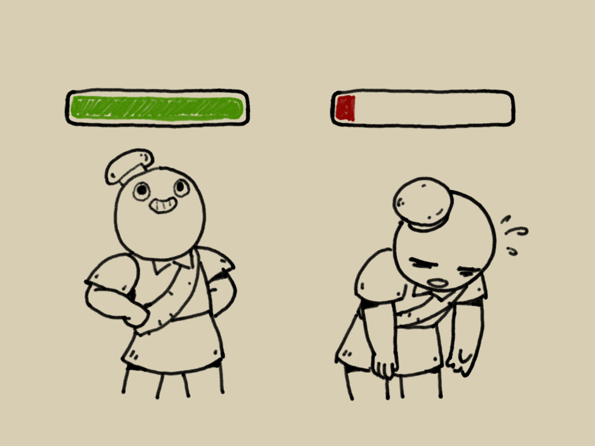
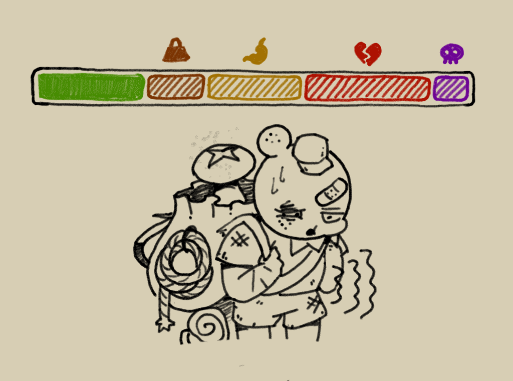
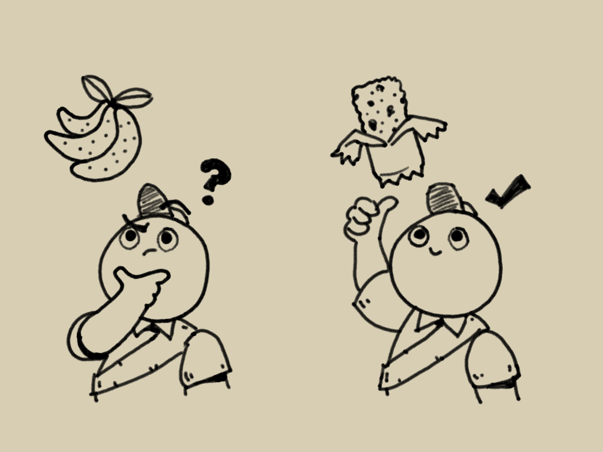
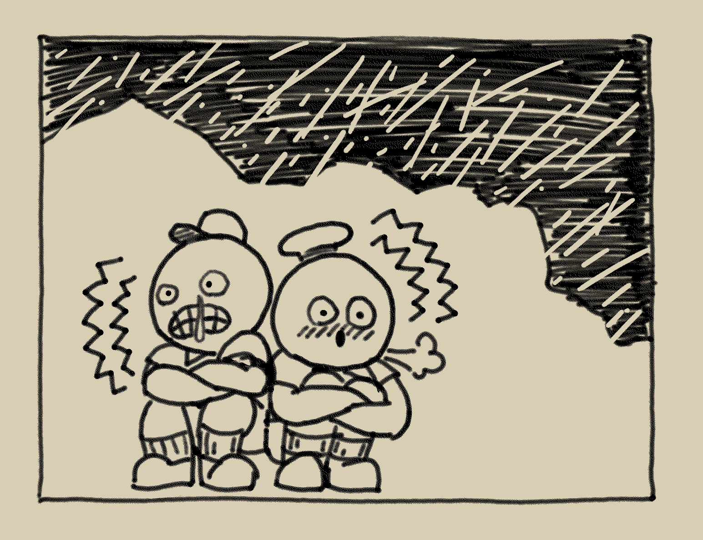
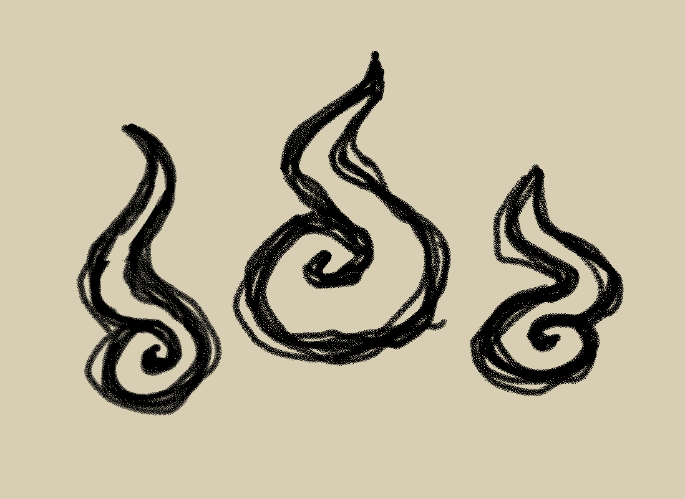

# 能量條

**能量條**是Template:Peak 遊戲中最核心的機制。它顯示了玩家當前可自然恢復的體力，也會顯示因狀態而受限無法使用的體力。

體力值和所有狀態都會以能量條百分比的形式來計算，但狀態可能會讓加總的百分比超過100%。超出的百分比會在能量條右側以虛線隔開，最多可超出200%。

除了體力值跟額外能量，其餘所有狀態在能量條上都能以每跳一次(2.5%)來量化。

## 體力

維持好體力是一個童軍最先決的要務。

**體力**是能量條中最重要的數值，只要還有體力，玩家就能夠攀爬或跑步。

不論攀爬、跑步或跳躍都會消耗玩家的體力，你會立刻在能量條上看到變化。一旦體力歸零，在它自然恢復前，玩家便無法繼續使用這些動作。

玩家在這些情況下是能夠恢復體力的：

- 正懸掛在 [岩釘](%E5%B2%A9%E9%87%98.md)上。
- 位置已經卡住不會動了，例如被[仙人掌](%E6%96%B9%E5%B1%B1.md#仙人掌)刺住。
- 雙腳已回到平地上**0.2秒***並且*：- 未耗盡體力：停止使用體力**1秒**
  - 已耗盡體力：停止使用體力**2秒**（即使擁有 [額外能量](#額外能量))

當體力開始恢復時，會以**每秒20%**的速度恢復。

在天階6或以上的難度，所有體力(包含 [額外能量](#額外能量))消耗的速度將增加40%。

體力消耗

| 動作 | 消耗 |
| --- | --- |
| 跑步 | 每秒**5** |
| 跳躍 | **5** |
| 衝刺跳躍 | **15** |

### Status Bonus stamina.png 額外能量

---

**額外能量**是等同於體力的備用資源，它會獨立顯示在能量條底下。

玩家將能量條中的體力耗盡後會接續使用額外能量來進行攀爬，跑步和跳躍都無法使用額外能量來進行。

額外能量只有在玩家食用特定[食物](%E9%A3%9F%E7%89%A9.md)或使用 [潘朵拉餐盒](%E6%BD%98%E6%9C%B5%E6%8B%89%E9%A4%90%E7%9B%92.md)才能獲得，無法自然產生。將食物[烹飪](%E7%83%B9%E9%A3%AA.md)後再食用能獲得更多額外能量。

若需要花費的體力比玩家當前的體力還多時，並不會使用額外能量。舉例來說：玩家在體力剩下2時跳躍(消耗5體力)，體力會歸零但仍不會使用到額外能量。

## 狀態

身上同時有太多狀態會使能活用的體力大幅下降。

**狀態**會降低玩家可以使用的體力。當身上的狀態多到沒有體力可以使用時，玩家便會暈倒。

### Status Weight.png 重量

---

將[道具](%E9%81%93%E5%85%B7.md)攜帶在手上、物品欄或裝備的[背包](https://peak.wiki.gg/wiki/Special%3AUpload%3FwpDestFile%3D%E8%83%8C%E5%8C%85.png) 背包中都會增加負重。攜帶[道具反重力繩](https://peak.wiki.gg/wiki/Special%3AUpload%3FwpDestFile%3D%E9%81%93%E5%85%B7%E5%8F%8D%E9%87%8D%E5%8A%9B%E7%B9%A9.png) 道具反重力繩或[氣球](https://peak.wiki.gg/wiki/Special%3AUpload%3FwpDestFile%3D%E6%B0%A3%E7%90%83.png) 氣球等特殊道具時，反正會降低玩家的負重。將攜帶的道具丟掉或消耗掉便能降低相對應的重量。

重量並不會影響玩家的移動速度或掉落傷害，也不會讓橋更容易斷裂。

在天階3或以上的難度時，除了[背包](https://peak.wiki.gg/wiki/Special%3AUpload%3FwpDestFile%3D%E8%83%8C%E5%8C%85.png) 背包外的所有道具的重量都會增加2.5。降低重量的道具也同樣會變重而非變輕，要注意變重後的這類道具仍然會因無重力的效果而飄走。

### Status Hunger.png 飢餓度

---

謹慎挑選食物可以更好的幫助降低飢餓度並避免中毒。

**飢餓度**會隨時間以**每秒0.05**的速度增加，但只有在數量達到2.5時才會反映到能量條上，也就是**每50秒增加1格**。玩家可以透過食用[食物](%E9%A3%9F%E7%89%A9.md)或是使用[萬靈藥](https://peak.wiki.gg/wiki/Special%3AUpload%3FwpDestFile%3D%E8%90%AC%E9%9D%88%E8%97%A5.png) 萬靈藥、 [潘朵拉餐盒](%E6%BD%98%E6%9C%B5%E6%8B%89%E9%A4%90%E7%9B%92.md)來降低飢餓度。

菜鳥新人難度中，飢餓度的增加速度會降低30%（約71.43秒跳一次）；天階2或以上的難度的增加速度則會提高60%（每31.25秒跳一次)。

食用[食物](%E9%A3%9F%E7%89%A9.md)並不會重置飢餓度的計算時間，它仍會以每秒0.05的速度增加。因此玩家可能會在進食後飢餓度又立刻跳一次。

### Status Injury.png 受傷

---

**受傷**的主要來源是玩家從極高處掉落，但也不乏其他來源，例如：

- 觸碰到岩漿河或是火山、熔爐等地形中的岩漿
- [炸藥](https://peak.wiki.gg/wiki/Special%3AUpload%3FwpDestFile%3D%E7%82%B8%E8%97%A5.png) 炸藥爆炸
- 蟻獅、殭屍攻擊
- 打開古代箱子
- 烹飪[照明棒](https://peak.wiki.gg/wiki/Special%3AUpload%3FwpDestFile%3D%E7%85%A7%E6%98%8E%E6%A3%92.png) 照明棒、[提燈](https://peak.wiki.gg/wiki/Special%3AUpload%3FwpDestFile%3D%E6%8F%90%E7%87%88.png) 提燈、[童子軍大砲](https://peak.wiki.gg/wiki/Special%3AUpload%3FwpDestFile%3D%E7%AB%A5%E5%AD%90%E8%BB%8D%E5%A4%A7%E7%A0%B2.png) 童子軍大砲或任何可燃物
- 被童軍大師抓住

受傷不會自然減少，只能透過以下手段治療：

- 點燃營火
- 使用[繃帶](https://peak.wiki.gg/wiki/Special%3AUpload%3FwpDestFile%3D%E7%B9%83%E5%B8%B6.png) 繃帶或[急救包](https://peak.wiki.gg/wiki/Special%3AUpload%3FwpDestFile%3D%E6%80%A5%E6%95%91%E5%8C%85.png) 急救包
- 有療效的[食物](%E9%A3%9F%E7%89%A9.md)：[藥用根莖](https://peak.wiki.gg/wiki/Special%3AUpload%3FwpDestFile%3D%E8%97%A5%E7%94%A8%E6%A0%B9%E8%8E%96.png) 藥用根莖、[黃脆莓](https://peak.wiki.gg/wiki/Special%3AUpload%3FwpDestFile%3D%E9%BB%83%E8%84%86%E8%8E%93.png) 黃脆莓、[黃荔莓](https://peak.wiki.gg/wiki/Special%3AUpload%3FwpDestFile%3D%E9%BB%83%E8%8D%94%E8%8E%93.png) 黃荔莓和[紅葚莓](https://peak.wiki.gg/wiki/Special%3AUpload%3FwpDestFile%3D%E7%B4%85%E8%91%9A%E8%8E%93.png) 紅葚莓。
- [療育菇](https://peak.wiki.gg/wiki/Special%3AUpload%3FwpDestFile%3D%E7%99%82%E8%82%B2%E8%8F%87.png) 療育菇的真菌雲
- [萬靈藥](https://peak.wiki.gg/wiki/Special%3AUpload%3FwpDestFile%3D%E8%90%AC%E9%9D%88%E8%97%A5.png) 萬靈藥
- [仙子提燈](https://peak.wiki.gg/wiki/Special%3AUpload%3FwpDestFile%3D%E4%BB%99%E5%AD%90%E6%8F%90%E7%87%88.png) 仙子提燈
-  [潘朵拉餐盒](%E6%BD%98%E6%9C%B5%E6%8B%89%E9%A4%90%E7%9B%92.md)的隨機效果

#### 掉落傷害

**掉落傷害**的計算方式主要取決於總掉落時長，而非與掉落速度關聯。

當掉落時長超過**1.5秒**玩家便會在落地時受到掉落傷害。掉落傷害最低會有5，最高可達到100。若此次掉落傷害是因為跳躍的動作，則總時長會**扣掉0.5秒**，意即跳躍後墜落3秒受到的掉落傷害等於墜落2.5秒受到的傷害。

在天階1或更高的難度下，掉落傷害都會變成**2倍**。

只要受到掉落傷害，該局遊戲便無法獲得Template:獎章，但只限於掉落傷害，其餘原因的受傷都不會影響成就進度。

掉落傷害計算方式

*此區塊適用至 [1.27.a](1.27.a.md).*

定義

| 項目 | 值 |
| --- | --- |
| 最小時間 | **1.5** |
| 最大時間 | **3.0** |
| 傷害係數 | - 菜鳥上路或頂峰難度：**1.0** - 天接1或以上：**2.0** |

- 掉落傷害與總掉落時長有正相關。掉落時長指的是「上次跳躍間至著地」或「上次與陸地接觸至這次著地」的時間。若玩家在掉落開始前0.05秒(50毫秒)內有進行跳躍動作，那總掉落時長便會扣掉0.5秒(500毫秒)。舉例來說，**跳下**山崖與**腳滑跌落**山崖便會有0.5秒的計算差異。- 若總掉落時長不到1.5秒，此次掉落便不會造成掉落傷害。
- *掉落值* 的公式為: 掉落值=clamp(掉落時長−最小時間最大時間−最小時間)1.5, 其中clamp函數會將公式內的值限制在0和1之間。
- *最高速度傷害* 的公式為: M.V.D.=clamp(|V|−10.020.0−10.0)1.5, 其中V的定義為：V=min⁡(玩家垂直速度,0).
- *最終傷害* 便可以列為 min⁡(max⁡(掉落值,0.05),M.V.D.)，這個公式便將最低掉落傷害限制在5(%)，最高則是等於M.V.D.。

### Status Poison.png 中毒

---

**中毒**的來源有：

- 食用有毒的或[燒焦](%E7%83%B9%E9%A3%AA.md#燒焦)的[食物](%E9%A3%9F%E7%89%A9.md)
- 觸碰到海岸的巨型海膽
- 觸碰到雨林的毒常春藤或巨大荊棘
- 站在雨林的毒蘑菇爆炸後產生的毒霧中
- 踩到海岸的水母
- 被[蜱蟲](https://peak.wiki.gg/wiki/Special%3AUpload%3FwpDestFile%3D%E8%9C%B1%E8%9F%B2.png) 蜱蟲附著
- 被[方山](%E6%96%B9%E5%B1%B1.md)的[蠍子](https://peak.wiki.gg/wiki/Special%3AUpload%3FwpDestFile%3D%E8%A0%8D%E5%AD%90.png) 蠍子或雨林的蜜蜂螫到
- 待在森蕈的蜘蛛網裡

玩家身上的毒會在**停止中毒後30秒**開始自然恢復，恢復速度為**每秒0.4**。其他的解毒方法包含：

- 食用[藥用根莖](https://peak.wiki.gg/wiki/Special%3AUpload%3FwpDestFile%3D%E8%97%A5%E7%94%A8%E6%A0%B9%E8%8E%96.png) 藥用根莖
- 使用[急救包](https://peak.wiki.gg/wiki/Special%3AUpload%3FwpDestFile%3D%E6%80%A5%E6%95%91%E5%8C%85.png) 急救包
- 喝下[解毒劑](https://peak.wiki.gg/wiki/Special%3AUpload%3FwpDestFile%3D%E8%A7%A3%E6%AF%92%E5%8A%91.png) 解毒劑
- 站在[靈藥菇](https://peak.wiki.gg/wiki/Special%3AUpload%3FwpDestFile%3D%E9%9D%88%E8%97%A5%E8%8F%87.png) 靈藥菇的真菌雲中
- 使用特殊道具中的[萬靈藥](https://peak.wiki.gg/wiki/Special%3AUpload%3FwpDestFile%3D%E8%90%AC%E9%9D%88%E8%97%A5.png) 萬靈藥、[仙子提燈](https://peak.wiki.gg/wiki/Special%3AUpload%3FwpDestFile%3D%E4%BB%99%E5%AD%90%E6%8F%90%E7%87%88.png) 仙子提燈或 [潘朵拉餐盒](%E6%BD%98%E6%9C%B5%E6%8B%89%E9%A4%90%E7%9B%92.md)。

### Status Cold.png 凍傷

---

記得抱團取暖來驅寒

**凍傷**的來源有：

- 冰原的暴風雪和冰岩
- 霧氣
- 天階5或以上的寒冷夜晚

只要玩家脫離會凍傷的環境，凍傷便會隨時間自然恢復。這個特性讓天階5或以上的寒冷夜晚變得非常致命，畢竟沒有遮蔽物能保護你避免凍傷累積至100。

別灰心，仍有其他方式可以削減凍傷：

- 跟其他童軍**抱團取暖**
- 使用[提燈](https://peak.wiki.gg/wiki/Special%3AUpload%3FwpDestFile%3D%E6%8F%90%E7%87%88.png) 提燈或[仙子提燈](https://peak.wiki.gg/wiki/Special%3AUpload%3FwpDestFile%3D%E4%BB%99%E5%AD%90%E6%8F%90%E7%87%88.png) 仙子提燈
- 使用[暖寶寶](https://peak.wiki.gg/wiki/Special%3AUpload%3FwpDestFile%3D%E6%9A%96%E5%AF%B6%E5%AF%B6.png) 暖寶寶
- 喝下[萬靈藥](https://peak.wiki.gg/wiki/Special%3AUpload%3FwpDestFile%3D%E8%90%AC%E9%9D%88%E8%97%A5.png) 萬靈藥
- 待在[方山](%E6%96%B9%E5%B1%B1.md)的[水池](%E6%96%B9%E5%B1%B1.md#綠洲)或冰原的溫泉裡
- 待在冰原的間歇泉旁
- 待在點燃的營火旁，失事地點的著火跟便攜火爐也可以

凍傷跟 [燒傷](#燒傷)不會並存，它們會依等比例彼此抵消。

#### 抱團取暖

當一個童軍距離另一個童軍**3.2公尺**內並且在**3秒內**沒有受到凍傷時，便會以**每秒1.5**的速度移除凍傷。

#### 寒冷夜晚

天階5或以上難度的夜晚會變得非常寒冷。要度過這樣的夜晚會讓玩家受到**97.5**的凍傷。

玩家到達火山後便不會再遇到這種夜晚。

### Status Heat.png 燒傷

---

**燒傷**的來源有：

- 食用雨林中的[火燒莓](https://peak.wiki.gg/wiki/Special%3AUpload%3FwpDestFile%3D%E7%81%AB%E7%87%92%E8%8E%93.png) 火燒莓
- 被[煮熟](%E7%83%B9%E9%A3%AA.md)的[吹箭](https://peak.wiki.gg/wiki/Special%3AUpload%3FwpDestFile%3D%E5%90%B9%E7%AE%AD.png) 吹箭射中
- 曝曬在[方山](%E6%96%B9%E5%B1%B1.md)的[烈陽](%E6%96%B9%E5%B1%B1.md#烈陽)下
- 碰到火山或熔爐的火岩
- 碰到任何類型的岩漿
- 碰到任何類型的火源，包含營火

玩家不再獲得燒傷達**8秒**後，燒傷便會以**每秒1.3**的速度恢復。其他治療燒傷的方式有：

- 喝下[運動飲料](https://peak.wiki.gg/wiki/Special%3AUpload%3FwpDestFile%3D%E9%81%8B%E5%8B%95%E9%A3%B2%E6%96%99.png) 運動飲料、[能量飲料](https://peak.wiki.gg/wiki/Special%3AUpload%3FwpDestFile%3D%E8%83%BD%E9%87%8F%E9%A3%B2%E6%96%99.png) 能量飲料、[奶白金](https://peak.wiki.gg/wiki/Special%3AUpload%3FwpDestFile%3D%E5%A5%B6%E7%99%BD%E9%87%91.png) 奶白金或[解毒劑](https://peak.wiki.gg/wiki/Special%3AUpload%3FwpDestFile%3D%E8%A7%A3%E6%AF%92%E5%8A%91.png) 解毒劑
- 使用[仙子提燈](https://peak.wiki.gg/wiki/Special%3AUpload%3FwpDestFile%3D%E4%BB%99%E5%AD%90%E6%8F%90%E7%87%88.png) 仙子提燈或[萬靈藥](https://peak.wiki.gg/wiki/Special%3AUpload%3FwpDestFile%3D%E8%90%AC%E9%9D%88%E8%97%A5.png) 萬靈藥
- 食用任何雪莓或[[刺莓】]
- 食用[半個椰子](https://peak.wiki.gg/wiki/Special%3AUpload%3FwpDestFile%3D%E5%8D%8A%E5%80%8B%E6%A4%B0%E5%AD%90.png) 半個椰子
- 食用[蘆薈](https://peak.wiki.gg/wiki/Special%3AUpload%3FwpDestFile%3D%E8%98%86%E8%96%88.png) 蘆薈
- 使用 [潘朵拉餐盒](%E6%BD%98%E6%9C%B5%E6%8B%89%E9%A4%90%E7%9B%92.md)
- 待在[方山](%E6%96%B9%E5%B1%B1.md)的[水池](%E6%96%B9%E5%B1%B1.md#綠洲)或冰原的溫泉裡

燒傷跟 [凍傷](#凍傷)不會並存，它們會依等比例彼此抵消。

### Status Thorns.png 尖刺

---

**尖刺**的來源有：

- [方山](%E6%96%B9%E5%B1%B1.md)的[仙人掌](https://peak.wiki.gg/wiki/%E4%BB%99%E4%BA%BA%E6%8E%8C)
- 拿起[仙人掌球](https://peak.wiki.gg/wiki/Special%3AUpload%3FwpDestFile%3D%E4%BB%99%E4%BA%BA%E6%8E%8C%E7%90%83.png) 仙人掌球
- 食用刺莓
- 被風滾草擊中

在這個狀態下，你可以看到童軍身上有可拔除的尖刺，類似於[蜱蟲](https://peak.wiki.gg/wiki/Special%3AUpload%3FwpDestFile%3D%E8%9C%B1%E8%9F%B2.png) 蜱蟲。一個童軍身上最多可以有36根尖刺，每個尖刺對玩家造成**2**尖刺。每一根尖刺會在30秒後自行消失，多人模式下則需要120秒。

[仙人掌球](https://peak.wiki.gg/wiki/Special%3AUpload%3FwpDestFile%3D%E4%BB%99%E4%BA%BA%E6%8E%8C%E7%90%83.png) 仙人掌球造成的尖刺會在你丟棄道具後立刻消失。

### Status Drowsy.png 睡意

---

**睡意**的來源有：

- 被[吹箭](https://peak.wiki.gg/wiki/Special%3AUpload%3FwpDestFile%3D%E5%90%B9%E7%AE%AD.png) 吹箭射中
- [能量飲料](https://peak.wiki.gg/wiki/Special%3AUpload%3FwpDestFile%3D%E8%83%BD%E9%87%8F%E9%A3%B2%E6%96%99.png) 能量飲料和[大棒棒糖](https://peak.wiki.gg/wiki/Special%3AUpload%3FwpDestFile%3D%E5%A4%A7%E6%A3%92%E6%A3%92%E7%B3%96.png) 大棒棒糖的效果結束後
- 靠近尚未摘採的[晚安莓](https://peak.wiki.gg/wiki/Special%3AUpload%3FwpDestFile%3D%E6%99%9A%E5%AE%89%E8%8E%93.png) 晚安莓
- 吃下[晚安莓](https://peak.wiki.gg/wiki/Special%3AUpload%3FwpDestFile%3D%E6%99%9A%E5%AE%89%E8%8E%93.png) 晚安莓
- 靠近正在大叫的[曼陀羅草](https://peak.wiki.gg/wiki/Special%3AUpload%3FwpDestFile%3D%E6%9B%BC%E9%99%80%E7%BE%85%E8%8D%89.png) 曼陀羅草

不再受到睡意攻擊10秒後，它會以**每秒1.5**的速度漸漸消退。其他解除睡意的方式有：

- 使用[萬靈藥](https://peak.wiki.gg/wiki/Special%3AUpload%3FwpDestFile%3D%E8%90%AC%E9%9D%88%E8%97%A5.png) 萬靈藥、[仙子提燈](https://peak.wiki.gg/wiki/Special%3AUpload%3FwpDestFile%3D%E4%BB%99%E5%AD%90%E6%8F%90%E7%87%88.png) 仙子提燈或 [潘朵拉餐盒](%E6%BD%98%E6%9C%B5%E6%8B%89%E9%A4%90%E7%9B%92.md)
- 喝下[運動飲料](https://peak.wiki.gg/wiki/Special%3AUpload%3FwpDestFile%3D%E9%81%8B%E5%8B%95%E9%A3%B2%E6%96%99.png) 運動飲料

### Status Curse.png 詛咒

---

**詛咒**的來源有：

- 被古老雕像復活後
- 吃人
- 使用[骸骨之書](https://peak.wiki.gg/wiki/Special%3AUpload%3FwpDestFile%3D%E9%AA%B8%E9%AA%A8%E4%B9%8B%E6%9B%B8.png) 骸骨之書

詛咒不會自然恢復，只能透過下列道具消除：

- [萬靈藥](https://peak.wiki.gg/wiki/Special%3AUpload%3FwpDestFile%3D%E8%90%AC%E9%9D%88%E8%97%A5.png) 萬靈藥
-  [潘朵拉餐盒](%E6%BD%98%E6%9C%B5%E6%8B%89%E9%A4%90%E7%9B%92.md)
- [煮過](%E7%83%B9%E9%A3%AA.md)的[曼德拉草](https://peak.wiki.gg/wiki/Special%3AUpload%3FwpDestFile%3D%E6%9B%BC%E5%BE%B7%E6%8B%89%E8%8D%89.png) 曼德拉草
- [骸骨之書](https://peak.wiki.gg/wiki/Special%3AUpload%3FwpDestFile%3D%E9%AA%B8%E9%AA%A8%E4%B9%8B%E6%9B%B8.png) 骸骨之書（特定情況下）

### Status Spores.png 孢子

---

**孢子**的來源有：

- 食用蘑菇莓（效果隨機，請參見相關頁面）
- 待在松蕈的孢子雲中
- 被蘑菇殭屍感染
- 待在深潭地形的水中
- 在有毒彈力菇上彈跳

停止受到孢子攻擊後**45秒**並且尚未受到感染，孢子便會以**每秒0.5**的速度痊癒。

其他治療孢子的方式有：

- [藥用根莖](https://peak.wiki.gg/wiki/Special%3AUpload%3FwpDestFile%3D%E8%97%A5%E7%94%A8%E6%A0%B9%E8%8E%96.png) 藥用根莖
- [解毒劑](https://peak.wiki.gg/wiki/Special%3AUpload%3FwpDestFile%3D%E8%A7%A3%E6%AF%92%E5%8A%91.png) 解毒劑
- [急救包](https://peak.wiki.gg/wiki/Special%3AUpload%3FwpDestFile%3D%E6%80%A5%E6%95%91%E5%8C%85.png) 急救包
- [仙子提燈](https://peak.wiki.gg/wiki/Special%3AUpload%3FwpDestFile%3D%E4%BB%99%E5%AD%90%E6%8F%90%E7%87%88.png) 仙子提燈
- [萬靈藥](https://peak.wiki.gg/wiki/Special%3AUpload%3FwpDestFile%3D%E8%90%AC%E9%9D%88%E8%97%A5.png) 萬靈藥
-  [潘朵拉餐盒](%E6%BD%98%E6%9C%B5%E6%8B%89%E9%A4%90%E7%9B%92.md)
- 站在[靈藥菇](https://peak.wiki.gg/wiki/Special%3AUpload%3FwpDestFile%3D%E9%9D%88%E8%97%A5%E8%8F%87.png) 靈藥菇的真菌雲中
- 蘑菇莓（效果隨機，請參見相關頁面）

食用[煮過](%E7%83%B9%E9%A3%AA.md)的蘑菇莓獲得的孢子會降低**5**。

### Status Web.png 蛛網

---

Main article: 蜘蛛

**蛛網**是蜘蛛造成的效果，當玩家被蜘蛛網困住時，需透過連打**空白鍵**來消除。

## 特殊效果

特殊效果指的是可以改變玩家行動策略或體力條外觀的短暫持續效果。

### 體力無限

---

**體力無限**期間，玩家的任何動作都不會消耗體力。

體力無限的來源有：

- 食用[大棒棒糖](https://peak.wiki.gg/wiki/Special%3AUpload%3FwpDestFile%3D%E5%A4%A7%E6%A3%92%E6%A3%92%E7%B3%96.png) 大棒棒糖
- 使用[友誼號角](https://peak.wiki.gg/wiki/Special%3AUpload%3FwpDestFile%3D%E5%8F%8B%E8%AA%BC%E8%99%9F%E8%A7%92.png) 友誼號角
- 食用蘑菇莓（效果隨機，請參見相關頁面）

### 麻木

---

**麻木**狀態下的體力條外觀

**麻木**狀態會將玩家的體力條隱藏起來，視覺效果會讓玩家無法確認當前體力與狀態，但不影響獲得/消除狀態。

麻木的來源有：

- 食用蘑菇莓（效果隨機，請參見相關頁面）
- 生吃[曼德拉草](https://peak.wiki.gg/wiki/Special%3AUpload%3FwpDestFile%3D%E6%9B%BC%E5%BE%B7%E6%8B%89%E8%8D%89.png) 曼德拉草

### 無敵

---

**無敵**狀態下，玩家的體力條外框會呈現金黃色，並且童軍的外觀也會發出金光。無敵期間，玩家除了 [重量](#重量)和 [詛咒](#詛咒)以外的所有狀態都不會增加，也不會被[炸藥](https://peak.wiki.gg/wiki/Special%3AUpload%3FwpDestFile%3D%E7%82%B8%E8%97%A5.png) 炸藥等影響擊飛，但仍可能會被感染或致盲。

無敵並不會影響體力消耗速度。

無敵的來源有：

- 手持[古老玩偶](https://peak.wiki.gg/wiki/Special%3AUpload%3FwpDestFile%3D%E5%8F%A4%E8%80%81%E7%8E%A9%E5%81%B6.png) 古老玩偶
- 喝下[奶白金](https://peak.wiki.gg/wiki/Special%3AUpload%3FwpDestFile%3D%E5%A5%B6%E7%99%BD%E9%87%91.png) 奶白金
- 食用蘑菇莓（效果隨機，請參見相關頁面）

## 備註

- 在半空中按下衝刺加速不會消耗體力。

## 版本歷程

 **[1.0](1.0.md) (2025-06-16):** 初版
 **[1.20.a](1.20.a.md) (2025-08-11):**

- 燒傷的恢復速度變快，但開始恢復的時間變長。火山的火岩會造成更多燒傷。
- 新增狀態"尖刺"

 **[1.30.a](1.30.a.md) (2025-09-23):** 抓放牆壁來向下移動花費的體力降低。
 **[1.40.a](1.40.a.md) (2025-11-05):**

- 新增狀態"孢子"和"蛛網"
- 修正隨時間增加的狀態（如飢餓度、中毒等）可能導致玩家即使體力條已被狀態佔滿卻不會暈倒。
- 額外能量現在會在童軍死亡後歸零
